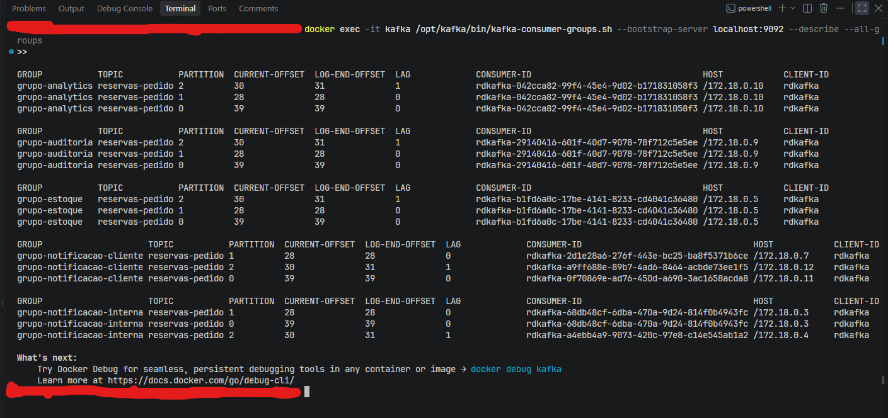

# Conceitos: tópico, partição, instância

Notas de referência sobre como o Kafka distribui mensagens, usando este
projeto como exemplo concreto. Para subir o ambiente, veja
[README-kafka.md](README-kafka.md); para a arquitetura dos serviços, veja
[README.md](README.md).

## Resumo rápido

| Termo | O que é |
|---|---|
| **Tópico** | O nome do canal. Aqui: `reservas-pedido`. |
| **Partição** | Uma das N filas independentes em que o tópico é dividido. |
| **Offset** | A posição de leitura dentro de uma partição. |
| **Consumer group** | Um time de consumidores identificado por um `group.id`. |
| **Instância** | Um processo em execução. Neste projeto, um container. |

## Tópico

O canal onde as mensagens são publicadas. O producer escreve nele, os
consumers leem dele. Neste projeto existe um só: `reservas-pedido`.

A armadilha é imaginar o tópico como uma fila única. Ele não é.

## Partição

**Um tópico é dividido em N filas independentes chamadas partições.** Cada
partição é um arquivo separado no disco do broker, com sua própria ordem e sua
própria numeração.

Quando o producer publica, a mensagem vai para **uma** partição só. Não existe
cópia entre partições.

```
topico "reservas-pedido", com 3 particoes:

  P0:  [pedido-a3f]  [pedido-91c]
  P1:  [pedido-7b2]
  P2:  [pedido-e40]  [pedido-2d8]  [pedido-cc1]
```

Neste projeto o tópico nasce com 3 partições por causa de
`KAFKA_NUM_PARTITIONS: 3` no [docker-compose.yml](docker-compose.yml). Sem
essa configuração, o padrão do Kafka é **1**.

Partições podem ser aumentadas depois, nunca diminuídas — mas aumentar tem uma
consequência sutil, descrita em
[a pegadinha de mudar o número de partições](#a-pegadinha-de-mudar-o-número-de-partições):

```powershell
docker exec -it kafka /opt/kafka/bin/kafka-topics.sh --bootstrap-server localhost:9092 --alter --topic reservas-pedido --partitions 6
```

## Offset

A posição de leitura dentro de uma partição: "esse grupo já leu até a
mensagem 42 da P1".

O offset é guardado **por grupo e por partição**, no próprio broker. Três
consequências práticas:

- Reiniciar um consumer o faz continuar de onde parou, não do começo.
- Trocar o `GROUP_ID` cria um grupo novo, sem offsets — e como todos os
  consumers aqui usam `auto.offset.reset: earliest`, ele relê o tópico
  inteiro desde o início. É a forma mais simples de reprocessar tudo.
- O broker guarda **um número por partição por grupo**, não o estado de cada
  mensagem. É por isso que o Kafka aguenta volumes altos.

## Consumer group

Um time de consumidores, identificado pelo `group.id`. Cada consumer deste
projeto tem o seu:

`grupo-notificacao-cliente`, `grupo-notificacao-interna`, `grupo-estoque`,
`grupo-analytics`, `grupo-auditoria`.

## Instância

Uma cópia do programa em execução — um processo. Neste projeto, um container.

Dizer que `consumer_notificacao_cliente` tem 3 instâncias significa: 3
containers rodando o mesmo `consumer.py`, com o mesmo `GROUP_ID`. São 3
membros do mesmo time, não 3 times.

## A regra central

> **Cada partição é entregue a no máximo um consumidor do grupo.**

Dessa única regra sai todo o resto.

Repare que ela já garante o que se espera de um consumer group — dois
consumidores do mesmo grupo nunca processam a mesma mensagem — sem precisar de
nenhuma verificação em tempo de execução. Se o `pedido-7b2` está na P1, e a P1
pertence à instância 2, é **estruturalmente impossível** que as instâncias 1 e
3 o vejam.

O ponto que costuma passar batido: **o Kafka não distribui mensagem por
mensagem. Ele distribui partições inteiras.** A partição é a unidade de
atribuição, e ela não se divide.

## Os dois eixos

Duas coisas independentes, que é onde a confusão costuma morar.

**Entre grupos diferentes → cópia.** Cada `group.id` tem seus próprios offsets
e lê o tópico inteiro, ignorando os outros grupos.

**Dentro de um mesmo grupo → divisão.** As partições são repartidas entre as
instâncias, pela regra acima.

| | O que acontece |
|---|---|
| Dois consumers no **mesmo** grupo | dividem as partições — cada pedido vai para um só |
| Dois consumers em grupos **diferentes** | ambos leem tudo, independentemente |

## Quantas instâncias por grupo

Mesmo tópico de 3 partições, variando só o número de instâncias do grupo:

```
1 instancia:          3 instancias:           4 instancias:

P0 ─┐                 P0 ──▶ instancia 1      P0 ──▶ instancia 1
P1 ─┼─▶ instancia 1   P1 ──▶ instancia 2      P1 ──▶ instancia 2
P2 ─┘                 P2 ──▶ instancia 3      P2 ──▶ instancia 3
                                                     instancia 4  ← ociosa
```

Em todos os casos o **grupo** processa 100% das mensagens, uma vez cada. O que
muda é quantos processos dividem esse trabalho.

No caso de 4 instâncias não sobrou partição para a última, e ela fica parada
indefinidamente. Daí a regra prática:

> **O número de partições é o teto do paralelismo dentro de um grupo.**

Instâncias além do número de partições não aceleram nada. Elas só servem como
reserva: se uma das ativas cair, o Kafka rebalanceia e a ociosa assume.

## Como o Kafka escolhe a partição

Pelo hash da *key* da mensagem, numa conta que na prática é:

```
particao = hash(key) % numero_de_particoes
```

Este projeto publica com `key=pedido["pedido_id"]` em
[producer/producer.py](producer/producer.py).

### A corrente de consequências

Dessa conta sai uma cadeia que vale memorizar, porque é o mecanismo que o
Kafka oferece para ordenação:

```
  mesma key
      ↓  (hash e deterministico)
  mesma particao
      ↓  (a particao pertence a uma instancia so)
  mesma instancia
      ↓  (dentro da particao a ordem e garantida)
  processamento em ordem, sempre pelo mesmo processo
```

Ou seja: **escolher a key é escolher o que será processado em ordem, e por
quem.** Não é um detalhe de distribuição — é uma decisão de modelagem.

### Na prática

Usar `pedido_id` como key significa: **a unidade de ordenação deste tópico é o
pedido.** Todos os eventos de um mesmo pedido vão para a mesma partição, logo
para a mesma instância, logo são processados na ordem em que foram publicados.

Hoje cada mensagem tem uma key diferente, mas não porque a key seja aleatória
— e sim porque o producer emite exatamente um evento por pedido. Se amanhã
existisse um `reserva_cancelada` carregando o mesmo `pedido_id` da criação, os
dois eventos cairiam na mesma partição automaticamente, e seria impossível
processar o cancelamento antes da criação. A key atual já está correta para
isso.

O que a key atual **não** ordena são eventos de pedidos diferentes — e é aí
que mora a decisão. Se a entidade que precisa de ordem não for o pedido, a key
precisa ser a dessa entidade.

Um exemplo concreto neste projeto: `consumer_estoque` decrementa
`ESTOQUE[produto]`. Dois pedidos distintos do mesmo `monitor-27-4k` têm
`pedido_id` diferentes, então podem cair em partições diferentes. Com uma
única instância isso não faz diferença. Mas se o estoque fosse escalado (com o
catálogo num banco compartilhado, como discutido adiante), duas instâncias
poderiam decrementar o mesmo produto **ao mesmo tempo** — uma corrida clássica
sobre o saldo. Passando a usar `produto` como key, todos os eventos daquele
produto iriam para a mesma partição e seriam serializados numa instância só,
e a corrida deixaria de existir.

É essa a pergunta a fazer quando escolher uma key: *qual entidade precisa ter
seus eventos processados em ordem, um em relação ao outro?* A resposta vira a
key. E note o custo embutido: keys concentradas dão ordem, mas também
concentram o tráfego numa partição — ordem e paralelismo puxam para lados
opostos.

### De quem é a decisão da key

Do **producer**, no momento da publicação. Não é do consumer nem do consumer
group.

```
producer  ──escolhe topico + key──▶  broker grava na particao X
                                            │
                     todos os grupos leem a MESMA divisao
                                            │
              ┌─────────────┬───────────────┴──────────────┐
              ▼             ▼                              ▼
        grupo-estoque   grupo-notificacao-cliente    grupo-analytics
```

Consequência: **não existe** "o grupo de estoque lê particionado por produto
enquanto o de notificação lê particionado por pedido". Quando a mensagem chega
a um consumer, ela já está numa partição — a decisão foi tomada na escrita, e
uma partição não se re-particiona por leitor.

O que *é* configurável por grupo é a **estratégia de atribuição**
(`partition.assignment.strategy`: `range`, `roundrobin`,
`cooperative-sticky`), que decide qual instância fica com qual partição dentro
daquele grupo. Repare na distinção: isso distribui partições entre instâncias;
não decide em qual partição a mensagem cai.

### Quando dois consumers precisam de chaves diferentes

Três saídas, da mais simples para a mais robusta.

**1. Keyar pelo requisito mais forte.** Na maioria dos casos resolve. A key só
importa para quem precisa de ordem ou para quem escala — um consumer stateless
processa cada mensagem isoladamente e não se importa com o particionamento.
Neste projeto, os consumers de notificação não teriam prejuízo algum se tudo
passasse a ser keyado por `produto` para servir o estoque.

**2. Publicar nos dois tópicos.** O producer emite o mesmo evento duas vezes,
cada uma com sua key. Simples, mas se a primeira escrita é aceita e a segunda
falha, o evento existe num tópico e não no outro — sem erro visível, sem lag,
apenas divergência silenciosa que nunca se corrige.

Há uma versão segura disso: **producer transacional**, em que as duas escritas
entram numa transação e ou ambas ficam visíveis, ou nenhuma fica.

```python
p = Producer({"bootstrap.servers": "...", "transactional.id": "produtor-reservas"})
p.init_transactions()

p.begin_transaction()
p.produce("reservas-pedido", key=pedido_id, value=payload)
p.produce("reservas-por-produto", key=produto, value=payload)
p.commit_transaction()   # atomico nos dois topicos
```

**3. Re-keying.** Um serviço consome o tópico original e republica num tópico
novo, trocando só a key. O segundo tópico não é uma segunda publicação — é uma
**derivação**, uma visão materializada dos mesmos eventos sob outro
particionamento:

```
reservas-pedido (key=pedido_id)          ← fonte da verdade, unica
        │
        ▼
  [servico re-key]  consome A, republica em B trocando a key
        │
        ▼
reservas-por-produto (key=produto)       ← derivado, reconstruivel
```

É o que o Kafka Streams faz sozinho ao agrupar por outro campo (cria um
*repartition topic* nos bastidores).

#### Por que o re-keying falha melhor

| | Publicação dupla (sem transação) | Re-keying |
|---|---|---|
| Falha no meio | evento fica só num tópico | offset não é commitado, reprocessa |
| Modo de falha | **perde** | **duplica** |
| Detecção | silenciosa | lag visível |
| Fonte da verdade | duas, de igual autoridade | uma, a outra deriva |

Perda é irrecuperável; duplicação é absorvível com processamento idempotente.
A disciplina que sustenta isso: **commitar o offset só depois que o produce
foi confirmado** — commitar antes traz a perda de volta.

#### Duas ressalvas

Re-keying **não cria ordem que não existia**. Ele garante co-locação: todos os
eventos de `monitor-27-4k` caem na mesma partição de B e são serializados numa
instância só. Mas se dois desses eventos estavam em partições diferentes de A,
a ordem em que chegam a B depende de qual partição foi lida primeiro. Para o
estoque isso basta (o que importa é não haver concorrência sobre o saldo);
para um caso em que a cronologia importa, o particionamento certo precisa
existir desde a origem.

E o custo de armazenamento é o mesmo das duas abordagens — o evento é gravado
duas vezes de qualquer jeito. A vantagem do re-keying não é espaço, é
consistência.

A pergunta que decide entre as duas: *os dois tópicos são fontes de igual
autoridade, ou um deriva do outro?* Se deriva, re-keying torna isso explícito
e permite reconstruir B a partir de A a qualquer momento.

### Sem key

Se o producer publica sem key (`key=None`), o Kafka distribui as mensagens
entre as partições sozinho, equilibrando o volume. Distribuição fica ótima, e
garantia de ordem entre mensagens relacionadas: nenhuma.

### A pegadinha de mudar o número de partições

A conta é `hash(key) % numero_de_particoes`. Se o número de partições muda, o
resultado muda:

```
hash("cliente-007") % 3  →  particao 1
hash("cliente-007") % 6  →  particao 4      (a mesma key, outro destino)
```

Então **aumentar as partições de um tópico quebra a garantia de "mesma key,
mesma partição" para as mensagens que já estão lá**. As antigas continuam onde
estavam; as novas passam a ir para outro lugar. Se você depende de ordenação
por key, isso é uma migração a ser planejada, não um ajuste de capacidade.

Em um tópico onde a ordem não importa — o caso deste projeto — aumentar
partições é inofensivo.

### A distribuição não é perfeitamente igual

O hash espalha bem, mas não em porções idênticas. Na saída real deste projeto,
com 98 mensagens em 3 partições, o `LOG-END-OFFSET` ficou **39 / 28 / 31**.
Quanto maior o volume, mais a diferença percentual some.

### Ordem no log

Efeito colateral de ter mais de uma partição: com um consumer lendo de 3
partições, a ordem em que as mensagens aparecem no log **não é** exatamente a
ordem de publicação. Dentro de cada partição a ordem é garantida; entre
partições, não.

## Neste projeto

Cada consumer roda com um número diferente de instâncias, de propósito, para
que o mesmo tópico mostre os cenários lado a lado:

| Serviço | Instâncias | Distribuição das 3 partições | Por quê |
|---|:---:|---|---|
| `consumer_notificacao_cliente` | 3 | 1 para cada | sem estado — paralelismo máximo |
| `consumer_notificacao_interna` | 2 | uma pega 2, outra pega 1 | sem estado — não precisa ser redondo |
| `consumer_estoque` | 1 | as 3 na mesma instância | estado em memória |
| `consumer_analytics` | 1 | as 3 na mesma instância | estado em memória |
| `consumer_auditoria` | 1 | as 3 na mesma instância | escrita concorrente no mesmo arquivo |

Os 5 grupos continuam recebendo **todos** os pedidos. O que varia é a divisão
interna de cada um.

### A tabela acima, na saída real



Gerada com `kafka-consumer-groups.sh --describe --all-groups` (veja
[README-kafka.md](README-kafka.md) para o comando completo). Lendo de cima
para baixo:

- **`grupo-analytics`, `grupo-auditoria` e `grupo-estoque`** — as 3 partições
  com o **mesmo** `CONSUMER-ID` e o mesmo `HOST`: a instância única segurando
  tudo.
- **`grupo-notificacao-cliente`** — 3 `CONSUMER-ID` **diferentes**, em 3 IPs
  diferentes (`172.18.0.7`, `.11` e `.12`). Uma partição para cada instância.
- **`grupo-notificacao-interna`** — a divisão desigual: o consumidor em
  `172.18.0.3` ficou com as partições 0 e 1, e o de `172.18.0.4` só com a
  partição 2.

Os 5 grupos estão no mesmo `LOG-END-OFFSET` por partição — todos leram as
mesmas mensagens. O `LAG 1` que aparece em algumas linhas é só uma mensagem
recém-publicada ainda não processada.

### Por que três serviços ficam em 1 instância

`consumer_estoque` guarda o catálogo no dict `ESTOQUE`, e `consumer_analytics`
guarda `faturamento_total` e `total_pedidos` — tudo na memória do processo.
Com 3 instâncias, cada uma teria sua própria cópia: três catálogos de 80
teclados, três faturamentos parciais. Os números impressos deixariam de
significar algo.

Isso não é um defeito do código — é exatamente o motivo pelo qual serviços com
estado em produção guardam esse estado num banco compartilhado em vez da
memória. Com um banco, esses dois escalariam como os outros.

`consumer_auditoria` é um caso diferente: várias instâncias escreveriam no
mesmo `data/auditoria.jsonl` através do bind mount do Windows, onde a
atomicidade do append não é garantida como seria num filesystem Linux nativo.

A lição embutida: **o teto de escala de um consumer é definido pelo próprio
serviço, não pelo Kafka.** O broker ofereceu 3 partições a todos igualmente.

## Comandos para observar

Atribuição real de partições por grupo — a coluna `PARTITION` ao lado de cada
`CONSUMER-ID` é o conceito virando concreto. A saída comentada está em
[a tabela acima, na saída real](#a-tabela-acima-na-saída-real):

```powershell
docker exec -it kafka /opt/kafka/bin/kafka-consumer-groups.sh --bootstrap-server localhost:9092 --describe --all-groups
```

Quantas partições o tópico tem de fato:

```powershell
docker exec -it kafka /opt/kafka/bin/kafka-topics.sh --bootstrap-server localhost:9092 --describe --topic reservas-pedido
```

Provocar o caso da instância ociosa (4 instâncias, 3 partições) — a quarta
sobe, entra no grupo e não processa nada:

```powershell
docker compose --profile apps up -d --scale consumer_notificacao_cliente=4
```

A interface web em http://localhost:8080 (`docker compose --profile ui up -d`)
mostra a mesma informação visualmente, incluindo o lag por partição.

## Em uma frase

Um **tópico** é dividido em **partições**; um **consumer group** recebe todas
as mensagens do tópico, e as **instâncias** desse grupo repartem as partições
entre si, uma partição para cada instância no máximo.
