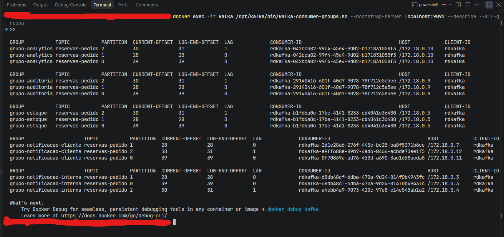

# Kafka local (Docker, modo KRaft)

Imagem oficial `apache/kafka:4.0.0`, um unico no (broker + controller), sem Zookeeper.

## Subir / derrubar

O compose tem dois profiles, entao o comando padrao sobe **so o broker** — util
quando voce roda os servicos Python pelo PyCharm:

```powershell
docker compose up -d                              # so o Kafka
docker compose --profile ui up -d                 # + interface web (localhost:8080)
docker compose --profile apps up -d --build       # + os 6 servicos da aplicacao
docker compose --profile apps --profile ui up -d --build   # tudo

docker compose down                  # para tudo (mantem os dados no volume)
docker compose down -v               # para tudo e APAGA os dados
```

> `down` so derruba o que o profile atual enxerga. Se subiu com
> `--profile apps`, derrube com `docker compose --profile apps down`.

## Acompanhando o que esta rodando

### Ver o estado dos containers

```powershell
docker compose --profile apps ps
```

Lista os containers do projeto e o estado de cada um (`running`, `exited`,
`restarting`). Com o profile `apps` no ar devem aparecer **10**: `kafka`,
`producer`, 3 instancias de notificacao-cliente, 2 de notificacao-interna,
estoque, analytics e auditoria.

O `--profile apps` e necessario aqui: sem ele o comando so enxerga o `kafka`, e
os servicos ficam fora da listagem **mesmo estando rodando**. Se algum container
aparecer como `restarting`, e sinal de que ele esta crashando em loop — veja os
logs dele.

### Seguir os logs de todos os servicos

```powershell
docker compose --profile apps logs -f
```

Mostra a saida de todos os containers ao mesmo tempo, intercalada e prefixada
com o nome de cada um. E a visao que torna o fan-out visivel: cada pedido
publicado pelo producer aparece logo em seguida nos 5 grupos, um `[estoque]`,
um `[analytics]`, um `[auditoria]` e assim por diante.

O `-f` (*follow*) deixa o comando preso acompanhando em tempo real. `Ctrl+C`
encerra o acompanhamento **sem parar os containers**.

Para nao afogar o terminal com o historico inteiro ao conectar:

```powershell
docker compose --profile apps logs -f --tail 20     # so as 20 ultimas linhas de cada
```

### Seguir os logs de um servico so

```powershell
docker compose logs -f consumer_estoque
```

Mesma coisa, mas de um servico apenas — util quando a saida intercalada passa
rapido demais para acompanhar. Aqui nao precisa do `--profile` porque o servico
foi nomeado explicitamente, e o Compose ativa o profile dele sozinho.

Num servico com varias instancias, esse comando mostra todas, cada linha
prefixada com o numero da instancia:

```powershell
docker compose logs -f consumer_notificacao_cliente
```

```
consumer_notificacao_cliente-1  | [notificacao-cliente] enviando e-mail...
consumer_notificacao_cliente-3  | [notificacao-cliente] enviando e-mail...
consumer_notificacao_cliente-2  | [notificacao-cliente] enviando e-mail...
```

Repare que pedidos diferentes caem em instancias diferentes, e **nenhum pedido
aparece duas vezes** — e a divisao por particao acontecendo na pratica.

## Endereco do broker

| Quem conecta                         | bootstrap.servers |
|--------------------------------------|-------------------|
| Codigo no Windows / PyCharm / CLI    | `localhost:9092`  |
| Outro container na mesma rede compose| `kafka:29092`     |

## Comandos CLI dentro do container

O Kafka traz suas ferramentas de linha de comando dentro da propria imagem, em
`/opt/kafka/bin`. Todas rodam via `docker exec` no container `kafka`.

### Quem esta com qual particao

```powershell
docker exec -it kafka /opt/kafka/bin/kafka-consumer-groups.sh --bootstrap-server localhost:9092 --describe --all-groups
```



O comando mais util do projeto: mostra, para **cada grupo**, qual instancia
esta responsavel por qual particao. E a teoria de
[CONCEITOS-KAFKA.md](CONCEITOS-KAFKA.md) virando saida concreta.

As colunas que importam:

| Coluna | O que diz |
|---|---|
| `GROUP` | o consumer group |
| `PARTITION` | qual das 3 particoes a linha descreve |
| `CURRENT-OFFSET` | ate onde esse grupo ja leu nessa particao |
| `LOG-END-OFFSET` | quantas mensagens existem nessa particao |
| `LAG` | a diferenca entre os dois — quantas faltam processar |
| `CONSUMER-ID` | **qual instancia** esta com essa particao |

Como ler, acompanhando a imagem acima:

- **`grupo-analytics`, `grupo-auditoria` e `grupo-estoque`** — as 3 particoes
  aparecem com o **mesmo** `CONSUMER-ID` e o mesmo `HOST`. E a instancia unica
  segurando tudo.
- **`grupo-notificacao-cliente`** — 3 `CONSUMER-ID` **diferentes**, em 3 IPs
  diferentes (`172.18.0.7`, `.11` e `.12`). Uma particao para cada instancia:
  a divisao 1:1.
- **`grupo-notificacao-interna`** — a divisao **desigual**: o consumidor em
  `172.18.0.3` ficou com as particoes 0 e 1, e o de `172.18.0.4` so com a
  particao 2. Duas instancias para tres particoes nao da numero redondo, e o
  Kafka nao exige que de.

Repare tambem que as particoes nao recebem o mesmo tanto de mensagem: na
imagem o `LOG-END-OFFSET` e 39 na particao 0, 28 na 1 e 31 na 2. O hash da key
distribui bem, mas nao perfeitamente — em volumes pequenos a diferenca
aparece.

`LAG` alto e crescente significa que o consumer nao esta dando conta do ritmo
do producer. Nesse projeto ele deve ficar perto de zero.

> Espere uns 20-30 segundos depois do `up -d` antes de rodar esse comando. Os
> consumers precisam conectar, entrar no grupo e o rebalanceamento acontecer —
> antes disso a saida vem vazia ou incompleta.

### Inspecionar o topico

```powershell
docker exec -it kafka /opt/kafka/bin/kafka-topics.sh --bootstrap-server localhost:9092 --list
```

Lista os topicos que existem no broker. Serve para confirmar que
`reservas-pedido` foi criado automaticamente no primeiro publish.

```powershell
docker exec -it kafka /opt/kafka/bin/kafka-topics.sh --bootstrap-server localhost:9092 --describe --topic reservas-pedido
```

Mostra **quantas particoes** o topico tem de fato e qual broker e o lider de
cada uma. E aqui que voce confirma se o `KAFKA_NUM_PARTITIONS: 3` pegou — se o
topico foi criado antes dessa configuracao existir, ele continua com 1
particao, porque a config so vale para topicos novos.

### Ler as mensagens pelo terminal

```powershell
docker exec -it kafka /opt/kafka/bin/kafka-console-consumer.sh --bootstrap-server localhost:9092 --topic reservas-pedido --from-beginning
```

Despeja o conteudo do topico no terminal, sem precisar escrever codigo. O
`--from-beginning` le desde a primeira mensagem; sem ele, so o que chegar dali
em diante.

Esse comando cria um consumer group temporario e descartavel, entao **nao
interfere** nos offsets dos seus 5 consumers. `Ctrl+C` para sair.

## Cliente Python

```powershell
.venv\Scripts\pip install -r requirements.txt
```

```python
from confluent_kafka import Producer

p = Producer({"bootstrap.servers": "localhost:9092"})
p.produce("reservas-pedido", b"ola")
p.flush()
```

## Imagens da aplicacao

Cada servico tem seu proprio `Dockerfile`, todos com **contexto de build na
raiz** do projeto (para compartilharem o `requirements.txt`):

```powershell
docker build -f producer/Dockerfile -t protocolo/producer .
docker build -f consumer_estoque/Dockerfile -t protocolo/estoque .
```

Na pratica nao precisa rodar isso na mao — `docker compose --profile apps up
-d --build` constroi as 6 imagens. O `.dockerignore` mantem `.venv/` e `data/`
fora do contexto.

## Notas

- `CLUSTER_ID` esta fixo no compose de proposito: assim o volume `kafka_data`
  continua valido quando o container e recriado.
- `KAFKA_NUM_PARTITIONS: 3` faz os topicos criados automaticamente nascerem
  com 3 particoes, o que permite escalar um consumer group e ver o
  rebalanceamento. Os conceitos por tras disso estao em
  [CONCEITOS-KAFKA.md](CONCEITOS-KAFKA.md).
- Para trocar de versao, altere a tag de `apache/kafka` (ex.: `apache/kafka:4.1.0`).
